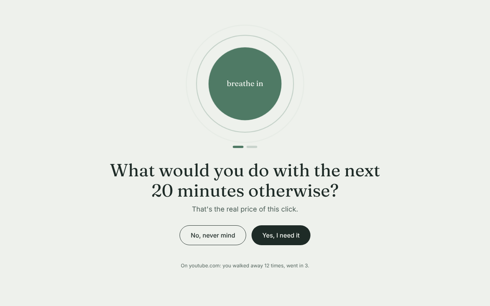
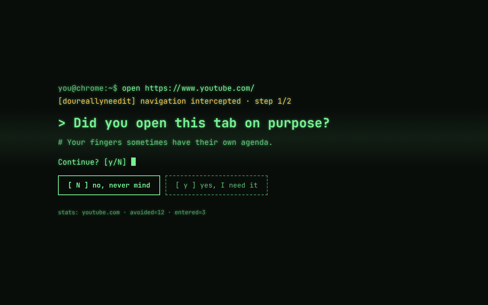
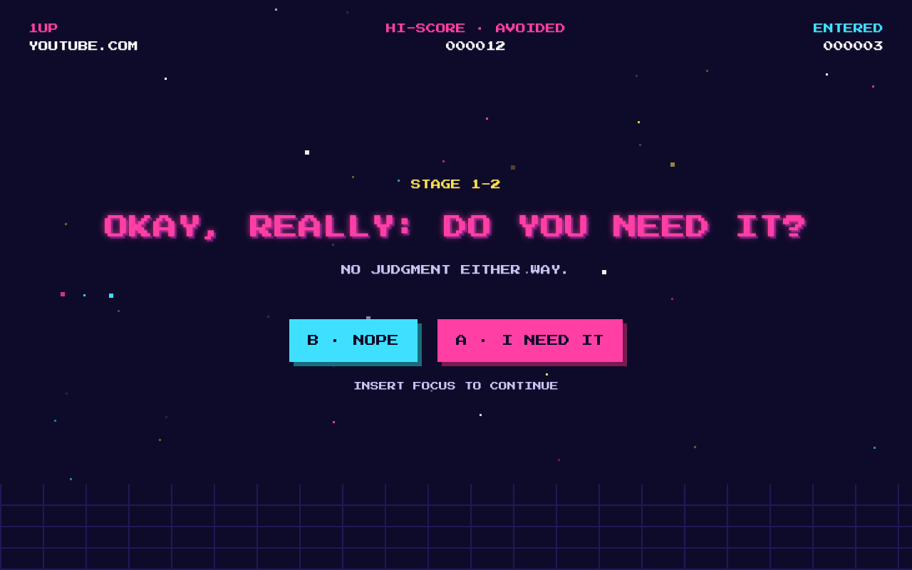
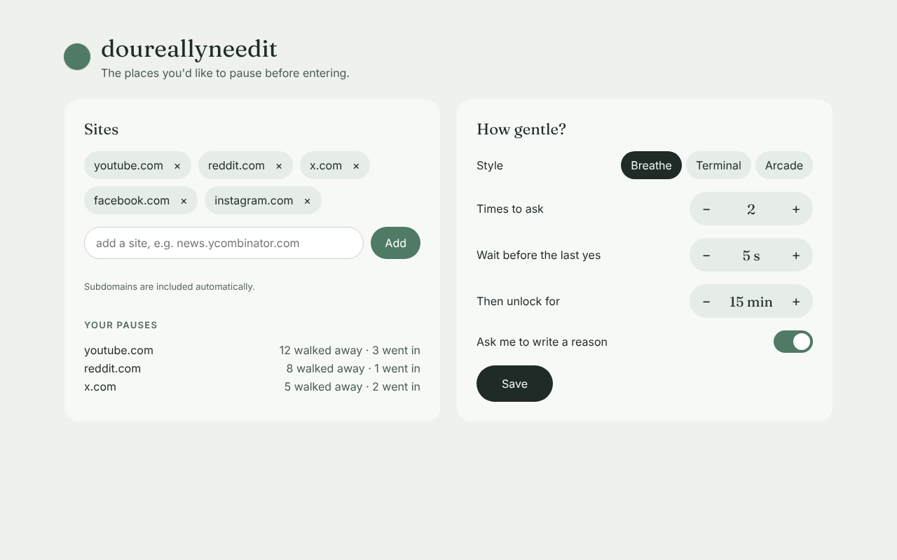
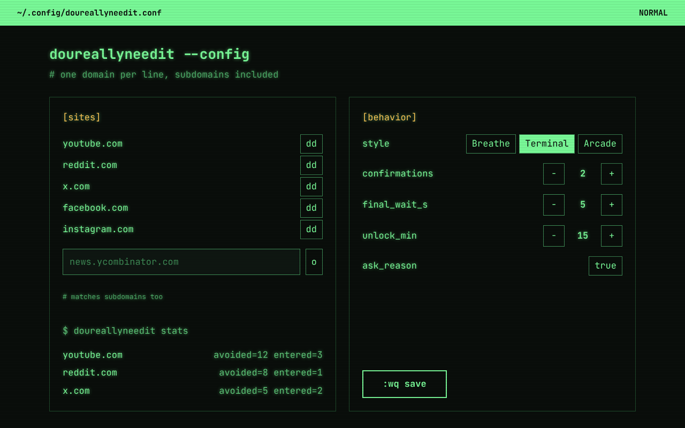
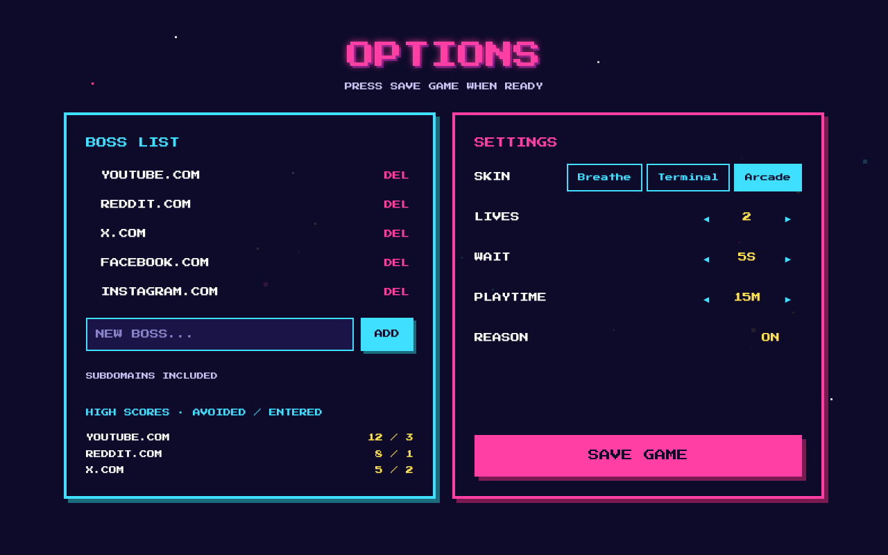

<div align="center">


# doureallyneedit

**A tiny Chrome extension that asks the one question your fingers never do:**

*do you really need to open that site right now?*

[](../../releases/latest)




</div>

---

## Why

You open a new tab, your hands type `you…`, and twenty minutes are gone.
**doureallyneedit** doesn't block anything. When you open one of the sites on your list, it puts a short pause in front of it and asks you a question (or two, or four). Sometimes the answer is yes, and that's fine. Most of the time it isn't.

## How it works

1. You navigate to a site on your list, for example `youtube.com`.
2. A confirmation page appears instead, with a question picked at random from a pool of **30 prompts**.
3. Answer **yes** enough times (you choose how many) and the site unlocks for a while, in every tab. The extension icon shows the minutes left.
4. When time is up, every open tab on that site goes back to the confirmation page, with a *time's up* note.
5. Answer **no** at any step and you're sent somewhere quieter. That counts as a win in your stats.

Optional extra friction: a short **"why?"** you have to type, and a **countdown** before the last *yes* becomes clickable.

## Three styles

Pick the one that works on you in the settings. Every new install starts with **Breathe**.

<table>
  <tr>
    <th width="33%">🌿 Breathe <sub>(default)</sub></th>
    <th width="33%">💻 Terminal</th>
    <th width="33%">👾 Arcade</th>
  </tr>
  <tr>
    <td></td>
    <td></td>
    <td></td>
  </tr>
  <tr>
    <td>Calm and slow. A breathing orb grows and shrinks while the question fades in.</td>
    <td>Green phosphor CRT, scanlines, a typed-out prompt and a blinking <code>[y/N]</code>.</td>
    <td>Twinkling stars, hi-scores for the times you walked away, and a <code>CONTINUE?</code> countdown.</td>
  </tr>
</table>

## Settings

Click the extension icon to open them. The settings page uses the same style you picked, and switching style previews it right away.

<table>
  <tr>
    <td></td>
    <td></td>
    <td></td>
  </tr>
</table>

| Setting | Default | What it does |
|---|---|---|
| **Sites** | youtube.com, reddit.com, x.com, facebook.com, instagram.com | The domains to pause on. Subdomains are included (`reddit.com` also covers `old.reddit.com`). |
| **Style** | Breathe | Breathe, Terminal or Arcade. |
| **Confirmations** | 2 | How many times you're asked (1–4). Each step gets a different question. |
| **Final wait** | 5 s | Countdown before the last *yes* can be clicked (0–60 s). |
| **Unlock for** | 15 min | How long the site stays open after you confirm, in all tabs. When it ends, open tabs on that site are locked again. |
| **Ask for a reason** | On | On the second step, you have to type at least three words about why you need the site. |

**Keyboard:** on the confirmation page, <kbd>y</kbd> means yes, <kbd>n</kbd> or <kbd>Esc</kbd> means no.

## Install

### From a release (quickest)

1. Download the latest `doureallyneedit-*.zip` from the [Releases page](../../releases/latest).
2. Unzip it.
3. Open `chrome://extensions` and turn on **Developer mode** (top right).
4. Click **Load unpacked** and select the extracted `doureallyneedit` folder.

To update, replace the folder with the new one and hit the reload button on the extension card.

### From source

```bash
git clone https://github.com/francescomalatesta/doureallyneedit.git
```

Then load the cloned folder with **Load unpacked**, as above.

## Privacy

- **No network requests.** Fonts are bundled, and there are no analytics or remote calls.
- **Your settings** sync between your own Chrome profiles with `chrome.storage.sync`.
- **Your stats** (walked away / went in, per site) stay on this device in `chrome.storage.local`.
- **Permissions:** `storage`, `webNavigation` (to notice when you open a site on your list), `tabs` (to find open tabs of a site when its time is up and to show the minutes left on the icon) and `alarms` (to know when time is up).

Full details in the [privacy policy](PRIVACY.md).

## Under the hood

```
manifest.json     MV3 manifest
background.js     watches navigations, redirects listed sites to the gate
gate.html/.js     the confirmation page
options.html/.js  the settings page
common.js         defaults, question pool, shared helpers
style.css         all three styles (Breathe, Terminal, Arcade)
fonts/            bundled fonts + licenses
icons/            extension icons
store/            Chrome Web Store listing kit (texts, screenshots, promo tiles)
```

A GitHub Action publishes a new release zip on every push to `main` that touches the extension. Changes to docs and Markdown files are ignored.

## Credits

Bundled fonts, all under the SIL Open Font License 1.1 (see `fonts/`): [Fraunces](https://github.com/undercasetype/Fraunces), [Inter](https://github.com/rsms/inter), [JetBrains Mono](https://github.com/JetBrains/JetBrainsMono), [Press Start 2P](https://fonts.google.com/specimen/Press+Start+2P).
